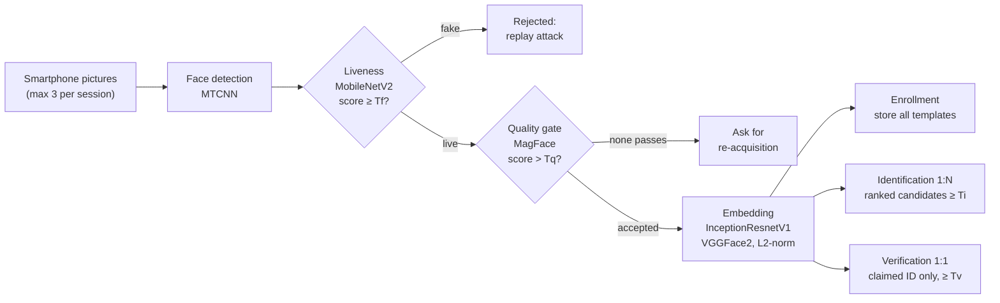
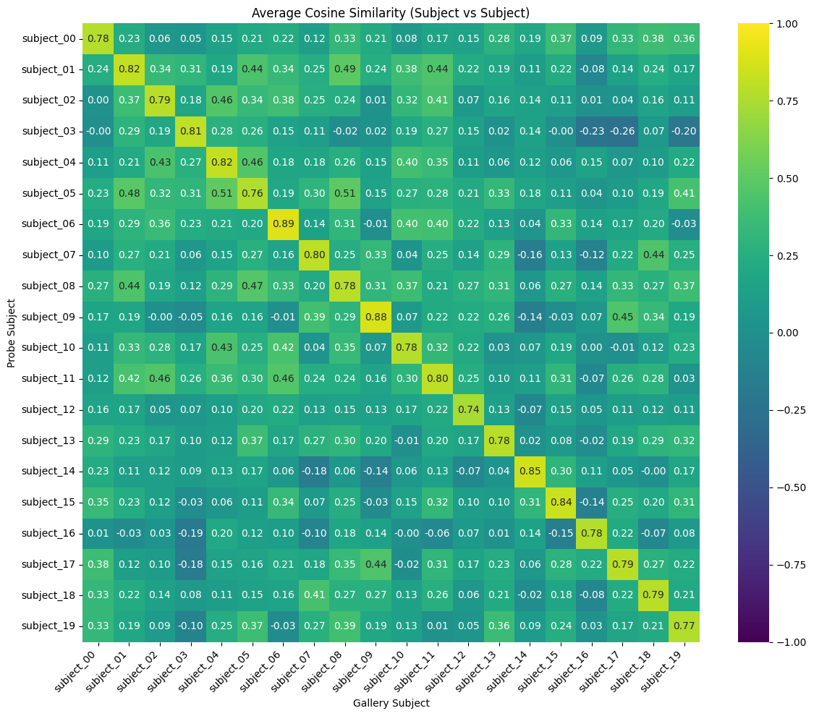
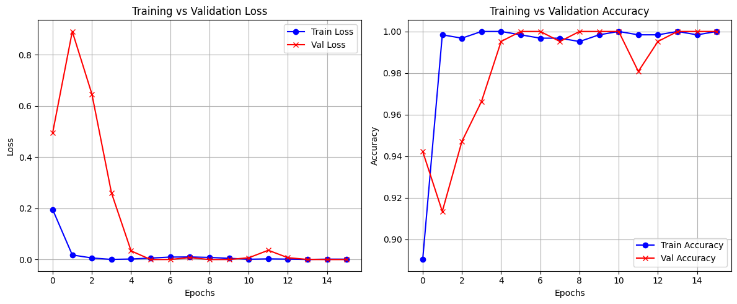

# Classroom Attendance System: Face Recognition with Liveness and Quality Control

A biometric authentication system designed to replace badge-based class attendance with **face recognition on
smartphone pictures**. It enrolls new users, identifies students in an open set (with a reject option for people
who are not enrolled), verifies claimed identities, and blocks **replay attacks** (a photo of a legitimate user shown
on a screen).

> Project work for the *Biometry and Behavioral Analysis* course (MSc Computer Engineering, University of Salerno, 2025/26).
> The full technical report is in [`docs/report.pdf`](docs/report.pdf).

**Highlights**
- An end-to-end pipeline: MTCNN detection, a MobileNetV2 liveness check, MagFace quality gate, InceptionResnetV1
  embeddings, and cosine matching.
- A data-driven choice of components: 3 face detectors and 7 feature extractors were benchmarked.
- Thresholds calibrated for security: FAR-constrained operating points estimated with stratified K-fold cross-validation.
- An Error-vs-Reject Characteristic (ERC) analysis to calibrate the face-quality threshold.
- A custom replay-attack dataset and a fully fine-tuned MobileNetV2 trained with a subject-disjoint split.
- Designed for the course constraints: under 4 GB of memory, a response in under 60 s, at most 3 acquisitions per
  session. Every demo run reports the processing time of each stage.

---

## Pipeline



- **Enrollment** stores the features of every accepted sample, never the images.
- **Identification** returns the list of enrolled users whose score is above `Ti`, ordered by score. An empty list
  means the user is unknown.
- **Verification** matches the probe only against the templates of the claimed identity and returns the score and
  a MATCH / REJECT decision.

All numbers below come from the experiments described in the [report](docs/report.pdf).

---

## 1. Dataset

A custom dataset was collected to reproduce real smartphone-based attendance:

- **Face recognition:** 520 JPEG images (9:16, front camera, arm's length) of **20 subjects**.
  - **Gallery** (enrollment): 160 images, 8 per subject.
  - **Probes** (test set): 360 images, 18 per subject, taken under varied lighting: natural light, low light,
    overexposure and directional light.
- **Liveness:** 1 036 images. The 520 originals are labelled *Real*. The 516 *Fake* images are re-captures of the
  same pictures shown on a computer screen, which simulates a replay attack. A custom dataset was preferred to public
  anti-spoofing datasets to avoid domain shift with respect to the operating conditions.

The dataset contains faces of real people, so it is **not published** (see [Privacy](#privacy)).

---

## 2. Face detection

Three detectors were compared on all 520 images:

| Detector | Recall | Total time | Avg. time / image |
|----------|:------:|:----------:|:-----------------:|
| **MTCNN** (facenet-pytorch) | **1.00** (520/520) | 155 s | 0.298 s |
| Viola & Jones (OpenCV) | 0.98 (510/520) | 82 s | 0.161 s |
| Dlib (HOG + linear SVM) | 0.97 (505/520) | 366 s | 0.745 s |

**MTCNN** was selected. It is the only detector that found every face, and its bounding boxes were the most
consistent. Viola & Jones is faster but produced visibly mis-cropped faces.

The detection module ([`face_detection.py`](face_auth/face_detection.py)) wraps the three libraries behind a single interface
that returns `(x, y, w, h)` boxes. It keeps the primary face of each image, then crops it, resizes it to 224×224 and
normalises it to [0, 1]. Faces can be returned in CHW format for the liveness CNN.

---

## 3. Feature extraction

Seven pretrained face-embedding models were evaluated with two complementary benchmarks. Both use the gallery
embeddings as templates and the probes as test images.

- **MLP classification:** an MLP is trained on the L2-normalised embeddings with grid search and 5-fold CV.
  This measures how separable the embedding space is.
- **Cosine Rank-1 identification:** each probe is matched against the gallery with cosine similarity. This is the
  metric that matters operationally, because the system matches embeddings directly.

| Model | Cosine Rank-1 | MLP accuracy |
|-------|:-------------:|:------------:|
| **InceptionResnetV1-VGGFace2** | **99.72%** | 96.11% |
| InceptionResnetV1-CASIA | 94.44% | 96.67% |
| ArcFace¹ | 98.89% | 96.39% |
| Facenet512¹ | 96.94% | 97.50% |
| GhostFaceNet¹ | 97.22% | 94.17% |
| SFace¹ | 97.22% | 94.44% |
| VGG-Face¹ | 94.17% | 94.72% |

¹ *DeepFace models. In this run they received RGB instead of the BGR images DeepFace expects (now fixed in the code),
so their scores are likely underestimated.*

**InceptionResnetV1-VGGFace2** was selected. It has the best cosine Rank-1 accuracy and extracts embeddings about
30× faster than ArcFace (4.04 s against 120.58 s for 520 faces). VGGFace2 is also a larger and more diverse training
set than CASIA-WebFace, which favours generalisation in the wild.

> In the original run the model was ranked on the probe set, which is also the final test set, so the probe metrics
> are slightly optimistic. The code now ranks the models with cross-validation on the gallery only.

<p align="center">
  
  <br>
  <em>InceptionResnetV1-VGGFace2 on the probe set. Left: normalised confusion matrix. Right: average cosine similarity between subjects.</em>
</p>

---

## 4. Threshold tuning (`Ti`, `Tv`)

Similarity scores are turned into decisions with two thresholds:

- **`Tv` (verification, 1:1)** is set on the dense distribution of **all impostor pairs**:
  `Tv = min{t : FAR(t) ≤ 0.1%}`, then a −0.045 bias makes it slightly more permissive for usability.
- **`Ti` (open-set identification, 1:N)** is set on the **maximum impostor score** of each probe. This models the
  worst case, an unknown person who looks like an enrolled one: `Ti = min{t : FAR_max(t) ≤ 0.1%}`.

The thresholds are calibrated **on the gallery only**, with image-disjoint stratified K-fold cross-validation: in
each fold, K−1 folds act as the gallery and the remaining fold acts as probes. The threshold is swept from 0 to 1 in
steps of 0.001 and averaged across folds. The probe set is not used here.

| K | Verification FAR | Verification FRR | Identification FNIR | Open-set FAR | `Tv` | `Ti` |
|:-:|:----------------:|:----------------:|:-------------------:|:------------:|:----:|:----:|
| **3** | 0.37% | 0.72% | 0% | 0% | **0.6013** | **0.6833** |
| 4 | 0.36% | 0.83% | 0% | 0% | 0.6020 | 0.6770 |
| 5 | 0.39% | 0.90% | 0% | 0% | 0.6096 | 0.6756 |

**K = 3** was selected because it gives the lowest error rates and the most stable thresholds across folds
(std(`Tv`) = 0.0005, std(`Ti`) = 0.0066).

**Results on the probe set (test):**

| Task | Metric | Value |
|------|--------|:-----:|
| Verification (2 880 genuine and 54 720 impostor comparisons) | FAR / FRR | **0.21% / 2.29%** |
| Identification (closed set) | Rank-1 identification rate (DIR) | **99.17%** |
| | FNIR (miss rate) | 0.83% |
| Identification (open set, each subject removed from the gallery in turn) | Open-set FAR | 0.83% |
| Rank-1 and Rank-2 identification at `Ti` | FAR / FRR | 0.00% / 0.83% (Rank-2 equals Rank-1) |

The probes contain harder lighting than the gallery, so a slight degradation with respect to the cross-validation
results was expected. The 0.83% FRR comes from genuine probes that were ranked first but scored just below `Ti`; there are
no ranking errors.

<p align="center">
  <br>
  <em>Probe set: genuine and impostor score distributions and error curves for verification (left) and identification (right).</em>
</p>

---

## 5. Liveness detection (`Tf`)

The replay-attack detector ([`liveness_detector.py`](face_auth/liveness_detector.py)) is a **MobileNetV2** initialised with
ImageNet weights and **fully fine-tuned**. Its 1000-class head is replaced by a single liveness logit.

- **Input:** the same MTCNN face crops the live system produces, so training matches deployment.
- **Split:** 60/20/20 train/validation/test, **subject-disjoint** (`GroupShuffleSplit` on the subject), so a
  subject's real images and their re-captured fakes always fall in the same split.
- **Training:** binary cross-entropy with logits (numerically more stable than sigmoid + BCE), at most 30 epochs,
  early stopping on validation loss with patience 10. The checkpoint with the best validation accuracy is kept.

Validation accuracy reached 100% with a validation loss of 0.0057 after 6 epochs, and the test set also scored
**100%** (0% False Live Rate, 0% False Fake Rate). The output probabilities are almost always exactly 0 or 1.

**Threshold `Tf`.** The Equal Error Rate was first estimated with 4-fold cross-validation, but the saturated score
distribution makes every threshold in the central range equivalent. The neutral value **`Tf = 0.5`** was adopted.

<p align="center">
  <br>
  <em>Training and validation loss and accuracy of the liveness detector.</em>
</p>

---

## 6. Image quality (`Tq`)

The acquisition module rejects low-quality samples before matching and asks the user for a new acquisition
([`face_quality.py`](face_auth/face_quality.py)).

- **Quality measure: MagFace.** General image-quality metrics such as sharpness or noise correlate poorly with
  recognition accuracy. MagFace instead learns embeddings whose **magnitude** grows with the sample's recognisability,
  so the norm of its feature measures *biometric utility*. Faces are aligned to the 112×112 MagFace template with the
  5 MTCNN landmarks.
- **Hybrid ERC analysis.** MagFace only provides the quality score. The error is measured with the system's own
  recognition model (InceptionResnetV1-VGGFace2), so the threshold reflects the real system's accuracy.
- **Error-vs-Reject Characteristic.** Samples are sorted by quality and the lowest R% are discarded, for R from 0% to
  50% in steps of 1%. For each R, the FNMR at a fixed FMR of 0.1% is computed on the surviving samples.
- **Selection (anchor and refine).** The anchor is the first rejection ratio that reaches the target error. The
  algorithm then picks the strictest quality threshold whose error stays within a tolerance of the anchor, with a
  hard limit of 30% rejected samples.

The selected threshold is **`Tq = 20.264`**, which rejects 29% of the samples with an expected FNMR of 2.39%.
(The report shows 20.364, which is a typo.)

> In the original run the ERC was computed on the probe set. The code now calibrates `Tq` with cross-validation on the
> gallery and uses the probes only to assess the result. The refinement tolerance is absolute
> (`refine_tolerance=0.05` means +5 FNMR points), so with this value the selected ratio tends to sit just below the
> 30% cap. A smaller tolerance rejects fewer samples.

<p align="center">
  <br>
  <em>Error-vs-Reject Characteristic used to select the MagFace quality threshold (original run, probe set).</em>
</p>

More figures are in [`docs/figures`](docs/figures): per-fold threshold tuning, the model comparison and the liveness
test-set analysis.

---

## Repository structure

```
├── face_auth/                         # Python modules of the system
│   ├── face_detection.py              # Viola-Jones / Dlib / MTCNN wrappers and face cropping
│   ├── liveness_detector.py           # MobileNetV2 replay-attack detector, dataset split, evaluation
│   ├── face_quality.py                # MagFace quality, quality gate, ERC calibration
│   ├── threshold_tuning.py            # Identification, verification, K-fold threshold calibration, metrics
│   ├── utilities.py                   # Data loading, embedding extraction, gallery, plots
│   ├── live_system_demo.py            # End-to-end session pipeline + command-line interface
│   └── iresnet.py                     # MagFace iResNet backbone (third-party, Apache-2.0)
├── notebooks/
│   ├── 01_face_authentication.ipynb   # Development: detector/extractor benchmarks, threshold tuning,
│   │                                  # liveness training, quality calibration, final evaluation
│   └── 02_system_demo.ipynb           # Live demo: Enrollment / Identification / Verification
├── models/
│   └── README.md                      # How to obtain the model weights
├── docs/
│   ├── report.pdf                     # Technical report
│   └── figures/                       # Plots used in this README
├── requirements.txt
└── LICENSE
```

---

## Getting started

```bash
git clone <this-repo-url> && cd Face_Recognition
python -m venv .venv && source .venv/bin/activate   # Windows: .venv\Scripts\activate
pip install -r requirements.txt
```

1. **Model weights.** Download the MagFace weights (`magface_iresnet50_MS1MV2_ddp_fp32.pth`) as described in
   [`models/README.md`](models/README.md). The liveness weights (`liveness_model.pth`) are **not distributed**,
   because they were trained on the faces of the dataset subjects. You can train your own with
   `notebooks/01_face_authentication.ipynb`, or run the demo with the liveness detector bypassed.
2. **Gallery.** Enroll users with the demo (Enrollment mode), or build the gallery from a dataset with
   `notebooks/01_face_authentication.ipynb`. The dataset must have this layout:
   ```
   Dataset/face_recognition/{galleries,probes}/subject_XX/**/*.jpg
   Dataset/liveness_detection/Liveness_Dataset/{galleries,probes}/{real,fake}/subject_XX/*.jpg
   ```
3. **Run the demo** in `notebooks/02_system_demo.ipynb`, or from the command line. Put up to 3 pictures of the user in a folder:
   ```bash
   python face_auth/live_system_demo.py enroll   --data-dir Test/alice --name alice --no-liveness
   python face_auth/live_system_demo.py identify --data-dir Test/alice --no-liveness
   python face_auth/live_system_demo.py verify   --data-dir Test/alice --claimed-id 0 --no-liveness
   ```
   Drop `--no-liveness` to enable the replay-attack detector once `models/liveness_model.pth` is available. The demo
   notebook enables it automatically when the weights are present. Each run prints the decision and the processing time of every stage. If no sample passes the liveness or
   quality checks, it asks for a new acquisition.

---

## Limitations and future work

- **Small dataset** (20 subjects, 520 images). The very low error rates need to be confirmed on larger,
  more diverse populations.
- **Liveness generalisation.** The 100% accuracy covers screen replays captured with the same devices. Cues
  specific to the acquisition device may be part of what the model learned. Next steps: cross-device tests,
  print and video attacks, and public anti-spoofing benchmarks (e.g. Replay-Attack, OULU-NPU).
- **Rejection rate.** With the current quality threshold about 29% of the samples are rejected. A real
  deployment would call for a gentler quality gate or for guidance during acquisition.
- **Future engineering work:** a packaged module with a config file, unit tests and CI, webcam acquisition,
  and an ONNX/TFLite export for on-device inference.

## Privacy

The dataset consists of face images of real people (classmates who volunteered). For this reason **no images,
galleries or biometric templates are published**. Notebook outputs that showed faces, and the face crops in
the report, were removed.

## License

[MIT](LICENSE). `iresnet.py` is adapted from [MagFace](https://github.com/IrvingMeng/MagFace) (Apache-2.0).
Pretrained models: [facenet-pytorch](https://github.com/timesler/facenet-pytorch),
[DeepFace](https://github.com/serengil/deepface), [MagFace](https://github.com/IrvingMeng/MagFace).
