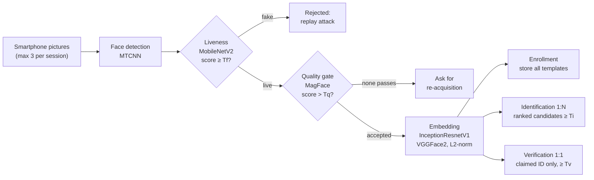
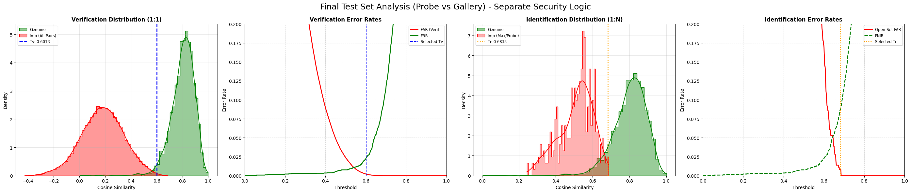
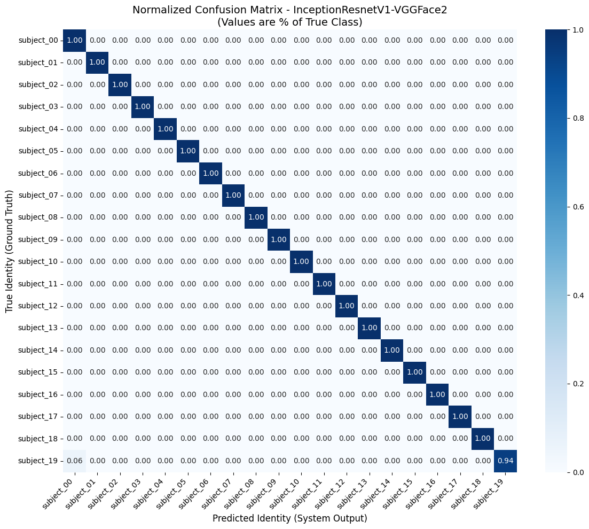
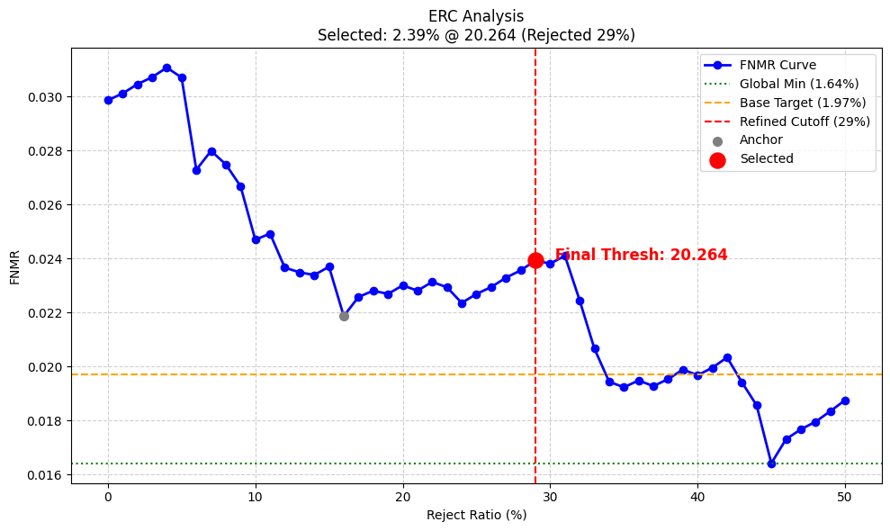

# Classroom Attendance System: Face Recognition with Liveness and Quality Control

A biometric authentication system designed to replace badge-based class attendance with **face recognition on
smartphone pictures**. It enrolls new users, identifies students in an open set (with a reject option for people
who are not enrolled), verifies claimed identities, and blocks **replay attacks** (a photo of a legitimate user shown
on a screen).

> Project work for the *Biometry and Behavioral Analysis* course (MSc Computer Engineering, University of Salerno, 2025/26).
> The full technical report is in [`docs/report.pdf`](docs/report.pdf).

**Highlights**
- An end-to-end pipeline: MTCNN detection, a MobileNetV2 liveness check, MagFace quality gate, InceptionResnetV1
  embeddings, and cosine matching.
- A data-driven choice of components: 3 face detectors and 7 feature extractors were benchmarked.
- Thresholds calibrated for security: FAR-constrained operating points estimated with stratified K-fold cross-validation.
- An Error-vs-Reject Characteristic (ERC) analysis to calibrate the face-quality threshold.
- A custom replay-attack dataset and a fully fine-tuned MobileNetV2 trained with a subject-disjoint split.
- Designed for the course constraints: under 4 GB of memory, a response in under 60 s, at most 3 acquisitions per
  session. Every demo run reports the processing time of each stage.

---

## Pipeline



| Module | Choice | Why |
|--------|--------|-----|
| Detection | **MTCNN** (facenet-pytorch) | Highest recall (520/520) compared with Viola-Jones and Dlib, with good crop quality |
| Feature extraction | **InceptionResnetV1-VGGFace2** | Best cosine Rank-1 accuracy, about 30× faster than ArcFace at embedding extraction |
| Liveness | **MobileNetV2**, ImageNet initialisation, full fine-tuning, BCE-with-logits | Lightweight CNN suited to mobile deployment |
| Quality (FIQA) | **MagFace** feature magnitude | Measures *recognition utility* rather than perceptual quality |
| Matching | Cosine similarity, best template per identity | Works with any number of templates per user |

---

## Results

All numbers come from the original run of the experiments described in the report. The test set is the probe set:
360 images of 20 subjects taken under varied lighting (natural light, low light, overexposure, directional light).

### Face detection (520 images)

| Detector | Recall | Avg. time / image |
|----------|:------:|:-----------------:|
| **MTCNN** | **1.00** | 0.298 s |
| Viola & Jones | 0.98 | 0.161 s |
| Dlib (HOG + SVM) | 0.97 | 0.745 s |

### Feature extractor comparison (probe set)

| Model | Cosine Rank-1 | MLP accuracy |
|-------|:-------------:|:------------:|
| **InceptionResnetV1-VGGFace2** | **99.72%** | 96.11% |
| InceptionResnetV1-CASIA | 94.44% | 96.67% |
| ArcFace¹ | 98.89% | 96.39% |
| Facenet512¹ | 96.94% | 97.50% |
| GhostFaceNet¹ | 97.22% | 94.17% |
| SFace¹ | 97.22% | 94.44% |
| VGG-Face¹ | 94.17% | 94.72% |

¹ *DeepFace models. In the original run they received RGB instead of BGR images, so their scores are likely
underestimated (see [Code review & fixes](#code-review--fixes)).*

### Matching thresholds (selected with K = 3)

| Threshold | Value | Calibration rule |
|-----------|:-----:|------------------|
| Verification `Tv` | 0.6013 | min t such that all-pairs impostor FAR ≤ 0.1%, then a −0.045 usability bias |
| Identification `Ti` | 0.6833 | min t such that max-impostor (open-set) FAR ≤ 0.1% |
| Liveness `Tf` | 0.5 | Scores are saturated near 0 and 1, so the EER offers no gain over 0.5 |
| Quality `Tq` | 20.264 | ERC analysis (the report shows 20.364, which is a typo) |

### System performance on the probe set

| Task | Metric | Value |
|------|--------|:-----:|
| Verification (1:1, 2 880 genuine and 54 720 impostor comparisons) | FAR / FRR | **0.21% / 2.29%** |
| Identification (1:N, closed set) | Rank-1 identification rate (DIR) | **99.17%** |
| | FNIR (miss rate) | 0.83% |
| Identification (open set, each subject removed from the gallery in turn) | Open-set FAR | 0.83% |
| Rank-1 and Rank-2 identification at `Ti` | FAR / FRR | 0.00% / 0.83% (Rank-2 equals Rank-1) |
| Liveness (held-out subjects) | Accuracy, False Live Rate, False Fake Rate | 100% / 0% / 0% |

<p align="center">
  <br>
  <em>Probe set: genuine and impostor score distributions and error curves for verification (left) and identification (right).</em>
</p>

<p align="center">
  
  <br>
  <em>Left: normalised confusion matrix (InceptionResnetV1-VGGFace2, probe set). Right: Error-vs-Reject Characteristic used to choose the MagFace quality threshold (original run).</em>
</p>

<p align="center">
  <br>
  <em>Liveness detector training: loss and accuracy on training and validation (early stopping on validation loss).</em>
</p>

More figures are in [`docs/figures`](docs/figures): per-fold threshold tuning, the subject similarity matrix,
the model comparison and the liveness test-set analysis.

---

## Methodology highlights

- **Threshold calibration without test leakage.** `Tv` and `Ti` are estimated with image-disjoint
  stratified K-fold cross-validation on the gallery (K ∈ {3, 4, 5}). In each fold, K−1 folds act as the gallery
  and one fold acts as probes. The probes are used only once, for the final evaluation.
- **Two threat models.** Verification uses the dense distribution of *all* impostor pairs. Open-set identification
  uses the *maximum* impostor score per probe, which models the worst case of an unknown person who looks like an
  enrolled one.
- **Quality as utility.** MagFace scores each face and the recognition model measures the resulting error. The
  ERC curve (FNMR at FMR = 0.1% against the rejection ratio) selects the strictest quality gate that does not
  hurt accuracy.
- **Liveness without leakage.** Each subject's genuine images and their re-captured fakes always fall in the same
  split (`GroupShuffleSplit` on the subject).
- **Behaviour of a real system.** The quality gate discards poor samples and asks for re-acquisition. Enrollment
  stores the features of every accepted sample and never the images. Verification compares the probe only with the
  claimed user's templates. Identification returns the ranked list of candidates above `Ti`.

---

## Repository structure

```
├── BBA_Project_G14.ipynb   # Development notebook: detector/extractor benchmarks, threshold tuning,
│                           # liveness training, quality calibration, final evaluation
├── system_demo.ipynb       # Live demo: Enrollment / Identification / Verification
├── live_system_demo.py     # End-to-end session pipeline + command-line interface
├── face_detection.py       # Viola-Jones / Dlib / MTCNN wrappers and face cropping
├── liveness_detector.py    # MobileNetV2 replay-attack detector, dataset split, evaluation
├── face_quality.py         # MagFace quality, quality gate, ERC calibration
├── threshold_tuning.py     # Identification, verification, K-fold threshold calibration, metrics
├── utilities.py            # Data loading, embedding extraction (facenet-pytorch / DeepFace), gallery, plots
├── iresnet.py              # MagFace iResNet backbone (third-party, Apache-2.0)
├── Models/README.md        # How to obtain the model weights
└── docs/                   # Report (PDF) and figures
```

---

## Getting started

```bash
git clone <this-repo-url> && cd Face_Recognition
python -m venv .venv && source .venv/bin/activate   # Windows: .venv\Scripts\activate
pip install -r requirements.txt
```

1. **Model weights.** Follow [`Models/README.md`](Models/README.md) to get `magface_iresnet50_MS1MV2_ddp_fp32.pth`
   and `liveness_model.pth`.
2. **Gallery.** Enroll users with the demo (Enrollment mode), or build the gallery from a dataset with
   `BBA_Project_G14.ipynb`. The dataset must have this layout:
   ```
   Dataset/face_recognition/{galleries,probes}/subject_XX/**/*.jpg
   Dataset/liveness_detection/Liveness_Dataset/{galleries,probes}/{real,fake}/subject_XX/*.jpg
   ```
3. **Run the demo** in `system_demo.ipynb`, or from the command line. Put up to 3 pictures of the user in a folder:
   ```bash
   python live_system_demo.py enroll   --data-dir Test/alice --name alice
   python live_system_demo.py identify --data-dir Test/alice
   python live_system_demo.py verify   --data-dir Test/alice --claimed-id 0
   python live_system_demo.py identify --data-dir Test/alice --no-liveness   # bypass the liveness detector
   ```
   Each run prints the decision and the processing time of every stage. If no sample passes the liveness or
   quality checks, it asks for a new acquisition.

---

## Code review & fixes

Before publication the code was reviewed and the following issues were fixed. The dataset is no longer available,
so the affected notebook cells have **not been re-run yet** and still show the outputs of the original code.

| Issue | Impact on the reported results |
|-------|--------------------------------|
| DeepFace models (ArcFace, Facenet512, VGG-Face, GhostFaceNet, SFace) received **RGB** crops, while DeepFace expects **BGR** | Their benchmark scores are probably underestimated. InceptionResnetV1 (the selected model) and every later stage are **not affected** |
| The feature extractor was selected, and the quality threshold calibrated, **on the probe set** that is also used for the final evaluation | Small optimistic bias in the final metrics. Both are now done with cross-validation on the gallery only |
| The standard deviations of `Tv` and `Ti` were **swapped** when the tuning results were unpacked | Only the reported std is affected (for K = 3: std(`Tv`) = 0.0005, std(`Ti`) = 0.0066). The thresholds and the choice of K are unchanged |
| The quality "gate" always kept the best sample, even below the threshold | Fixed: samples below the threshold are discarded and re-acquisition is requested |
| Verification printed comparisons against the whole gallery. Identification returned only the top-1 match | Fixed according to the system specification |
| Faces and file paths could become misaligned when a detection failed | Fixed: `detect_faces` returns the paths of the kept images |
| The plotted "FNIR" curve reused the image-level FRR | The curve is now the per-probe Rank-1 miss rate (plots only, the thresholds are not affected) |

Also fixed: `sys.exit()` calls inside library code, a missing branch in `compute_fnmr_at_fmr`, unsafe `torch.load`
calls, duplicated and unused code, and heavy imports (DeepFace/TensorFlow, dlib) that are now loaded only when needed.

The ERC refinement step uses an **absolute** tolerance (`refine_tolerance=0.05`, i.e. +5 FNMR points around the
anchor). With this value the selected rejection ratio tends to sit just below the 30% cap. A smaller tolerance
keeps the error closer to the anchor and rejects fewer samples.

---

## Limitations and future work

- **Small dataset** (20 subjects, 520 images). The very low error rates need to be confirmed on larger,
  more diverse populations.
- **Liveness generalisation.** The 100% accuracy covers screen replays captured with the same devices. Cues
  specific to the acquisition device may be part of what the model learned. Next steps: cross-device tests,
  print and video attacks, and public anti-spoofing benchmarks (e.g. Replay-Attack, OULU-NPU).
- **Rejection rate.** With the current quality threshold about 29% of the probes are rejected. A real
  deployment would call for a gentler quality gate or for guidance during acquisition.
- **Future engineering work:** a packaged module with a config file, unit tests and CI, webcam acquisition,
  and an ONNX/TFLite export for on-device inference.

## Privacy

The dataset consists of face images of real people (classmates who volunteered). For this reason **no images,
galleries or biometric templates are published**. Notebook outputs that showed faces, and the face crops in
the report, were removed.

## License

[MIT](LICENSE). `iresnet.py` is adapted from [MagFace](https://github.com/IrvingMeng/MagFace) (Apache-2.0).
Pretrained models: [facenet-pytorch](https://github.com/timesler/facenet-pytorch),
[DeepFace](https://github.com/serengil/deepface), [MagFace](https://github.com/IrvingMeng/MagFace).
